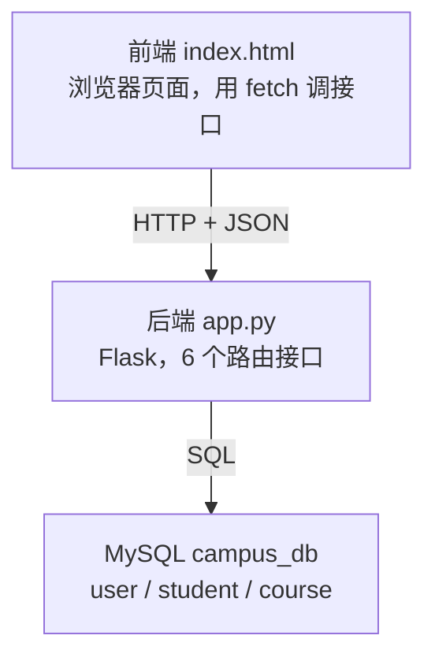
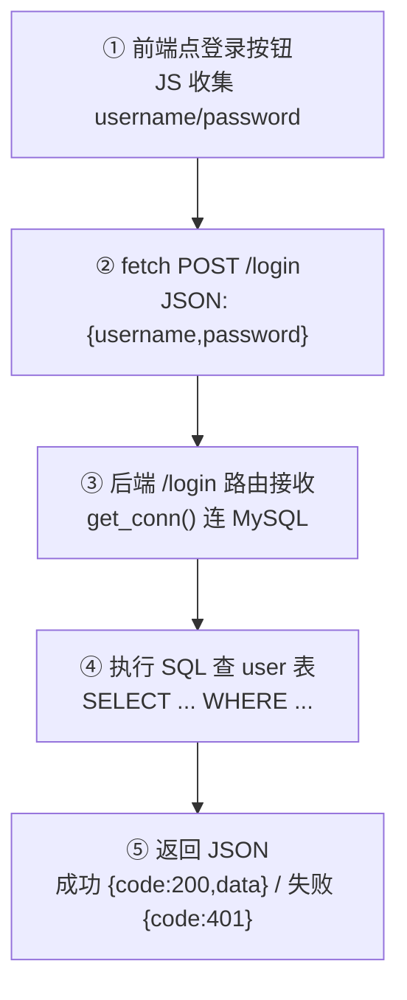

# 项目一讲解总览：校园信息管理系统（Python + Flask）

> 本文把项目一从"是什么"讲到"每一行怎么跑"，配合 `app.py` / `index.html` / `db_init.sql` 三个文件阅读效果最佳。
> 详细分步操作见同目录 `项目1-Flask校园信息系统-详细教程.md`。

---

## 一、项目一到底是什么

对应你简历上的 **「校园信息管理系统（Python + Flask）」**。本质是一个用 Python 写的**后端服务**，配套一个 MySQL 数据库；另外额外送了一个前端页面 `index.html`，所以它现在是"前后端都有"的小系统。

- **能干什么**：管学生（增删改查）、管课程（列表展示）、管登录（账号校验）。
- **技术栈**：Python 3 + Flask（轻量 Web 框架）+ PyMySQL（Python 连 MySQL 的驱动）+ MySQL 8。
- **简历意义**：证明会"搭后端、写接口、连数据库、做前后端交互"——后端开发最基础的四项能力。

---

## 二、整体架构（三层）



| 层 | 文件 | 职责 |
|---|---|---|
| 前端 | `index.html` | 浏览器里看到的界面，用户点按钮 → 用 `fetch` 发 HTTP 请求 |
| 后端 | `app.py` | 接收请求、写业务逻辑、连数据库、把结果包装成 JSON 返回 |
| 数据库 | MySQL `campus_db` | 存真实数据，三层里唯一"落地"的地方 |

**关键理解**：前端和后端靠「HTTP + JSON」说话（前后端分离）；后端和数据库靠「SQL」说话。这就是现代 Web 项目最经典的"三层架构"，以后学 Spring Boot 也是这套思路。

---

## 三、数据库设计（3 张表，对应 `db_init.sql`）

```sql
user    (id, username 唯一, password, role)        -- 登录账号
student (id, name, gender, major, grade)           -- 被管理的学生对象
course  (id, name, teacher, credit)                -- 课程信息
```

- `user` 表已插入测试账号 `admin / 123456`，用于测 `/login`。
- **为什么拆成三张表？** 因为"登录用户""学生""课程"是三种不同事物，分开存符合数据库设计的基本规范，互不干扰。

---

## 四、后端 `app.py` 逐块讲解（核心）

### 1. 导入 + 配置（13–29 行）
- `Flask` 框架本体；`request` 收前端数据；`jsonify` 把字典变 JSON 响应。
- `CORS(app)`：允许前端页面（不同端口）跨域调用，否则浏览器会拦截。
- `DB_CONFIG` 里密码写成 `os.getenv("DB_PASSWORD","123456")`——优先读环境变量，没有就默认 123456（直接跑能用，仓库公开也不泄露密码）。

### 2. 连接工具 `get_conn()`（32–34 行）
所有接口共用"拿数据库连接"的函数，避免重复写连接代码。

### 3. 六个接口（37–132 行）
每个接口用 `@app.route("路径", methods=[...])` 把"URL + HTTP 方法"绑定到一个函数：

| 接口 | 方法 | 功能 | 关键 SQL |
|---|---|---|---|
| `/login` | POST | 校验账号 | `SELECT ... WHERE username=? AND password=?` |
| `/student/add` | POST | 新增学生 | `INSERT INTO student(...)` |
| `/student/list` | GET | 查全部学生 | `SELECT * FROM student` |
| `/student/update` | POST | 改学生 | `UPDATE student SET ...` |
| `/student/delete` | POST | 删学生 | `DELETE FROM student` |
| `/course/list` | GET | 查课程 | `SELECT * FROM course` |

### 4. 统一安全模板（面试必考）
每个接口都长这样：
```python
conn = get_conn()
try:
    with conn.cursor() as cur:
        cur.execute("SQL", (参数,))   # %s 占位，元组传参 → 防 SQL 注入
        conn.commit()                 # 增删改必须提交，否则不生效
    return jsonify(成功)
except Exception as e:
    conn.rollback()                   # 出错回滚，保证数据一致
    return jsonify(失败)
finally:
    conn.close()                      # 无论成败都关连接，防泄漏
```
- `commit()` = 写操作落库；`rollback()` = 出错撤销；`finally/close()` = 连接必须还回去。
- 参数用 `%s` 占位 + 元组传参，是**防 SQL 注入**的标准写法。

### 5. 启动（135–136 行）
`app.run(debug=True, port=5000)` → 监听 `http://localhost:5000`。

---

## 五、一次请求的完整流程（以登录为例）



---

## 六、前端 `index.html`（可视化界面）

- **HTML**：三个卡片（①登录 ②学生管理 ③课程列表）。
- **JS**：核心是 `api(method, path, payload)` 函数，用 `fetch(BASE+path, ...)` 发请求；点按钮就调用它，再把返回的 JSON 显示到页面。
- 这就是"前后端分离"：前端不管逻辑，只负责发请求、展示结果。

---

## 七、运行回顾（已实际跑通）

安装依赖 → Navicat 建 `campus_db` 三张表 → 密码默认 123456 → `python app.py` → 用 `test_api.py` 实测 8 个接口**全部返回 code:200**，增删改查真实生效。

---

## 八、简历技能点映射 + 面试话术

- 对应简历写法：**"了解 Flask 后端搭建、路由配置，实现学生/课程的增删改查接口与前后端交互"**。
- 面试可直接说：
  > 我用 Flask 写了个校园信息管理系统，前后端分离，提供了登录、学生增删改查、课程列表等 6 个 RESTful 接口，用 PyMySQL 连 MySQL，接口做了统一异常处理和 SQL 防注入。

---

## 附：本地运行命令
```
cd flask-campus-system
python app.py            # 启动后端（保持窗口开着，监听 :5000）
python test_api.py       # 另开终端跑接口自测
# 浏览器打开 index.html 即可看到可视化界面
```
